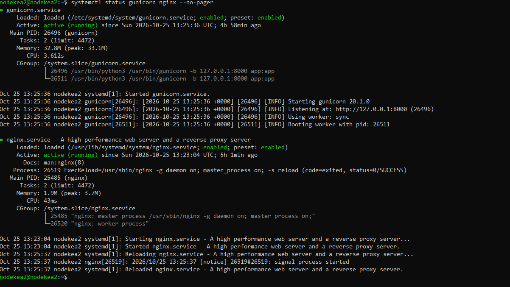
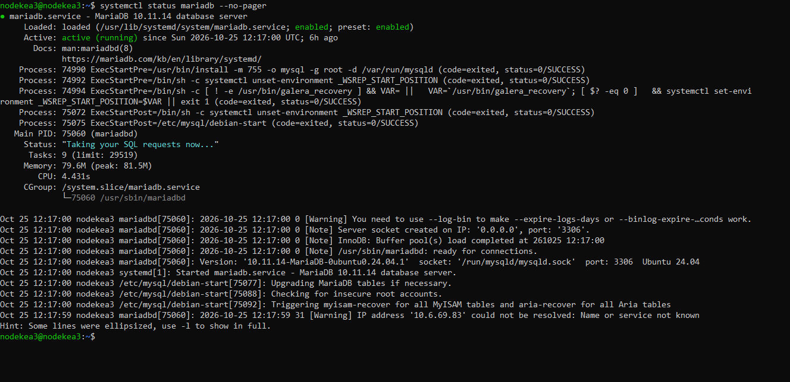
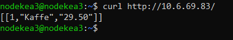
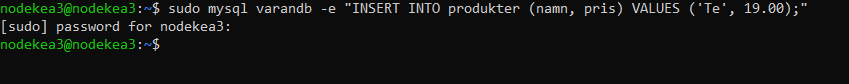
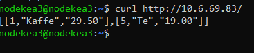

# Flerskiktsapplikation med Ansible

En sammansatt playbook som sätter upp en Flask-app på en webbnod och MariaDB på en databasnod. Alla tjänster körs via systemd.

```
Klient ──► :80 Nginx ──► :8000 Gunicorn ──► Flask ──► :3306 MariaDB
           └──────── nodekea2 (10.6.69.83) ────────┘   └ nodekea3 (10.6.69.102) ┘
```

## Roller

**db** (`nodekea3`)
- Installerar och startar MariaDB.
- Skapar databasen `varandb`, användaren `admintest` (endast tillåten från `10.6.69.83`) och tabellen `produkter` med testdata.
- Sätter `bind-address = 0.0.0.0` i `/etc/mysql/mariadb.conf.d/99-override_bind.cnf`. Prefixet `99-` behövs för att skriva över `50-server.cnf`, som annars binder till `127.0.0.1`.

**flaskapp** (`nodekea2`)
- Installerar Nginx, Gunicorn, Flask och PyMySQL.
- Flask-appen (`/opt/app.py`) returnerar alla rader i `produkter` som JSON.
- Gunicorn körs som systemd-tjänst på `127.0.0.1:8000`, och Nginx skickar trafik från port 80 vidare till den.

Handlers startar bara om tjänsterna när deras konfiguration ändras.

Sista playen i `site.yml` skriver en rapport per nod, `<värdnamn>_inventory_report.md`, i repomappen med mallen `templates/gatherindex.html.j2`.

Arkitekturmotiveringen finns i [ARCHITECTURE.md](ARCHITECTURE.md).

## Variabler

| Variabel | Beskrivning |
|---|---|
| `vault_db_passwd` | Lösenord för `admintest` (Ansible Vault) |

## Körning

Förberedelser på kontrollnoden (en gång):

```bash
ansible-galaxy collection install -r requirements.yml   # ansible.posix och ansible.mariadb
chmod +x Scripts/script.py                              # inventoryt måste vara körbart
```

Vault-lösenordet ska ligga i `~/vault-secretpasswd.txt` (se `ansible.cfg`), alltså utanför repot.

Kör hela projektet (`-K` frågar efter sudo-lösenordet):

```bash
ansible-playbook -i Scripts/script.py site.yml -K
```

## Verifiering

**1. Tjänsterna körs**

```bash
systemctl status gunicorn nginx   # nodekea2
systemctl status mariadb          # nodekea3
```





**2. Appen svarar via Nginx**

```bash
curl http://10.6.69.83/
# [[1,"Kaffe","29.50"]]
```



**3. Datan kommer från databasen**

```bash
sudo mysql varandb -e "INSERT INTO produkter (namn, pris) VALUES ('Te', 19.00);"   # nodekea3
curl http://10.6.69.83/                                                          # Te syns nu
```





Den nya raden syns utan omstart, vilket visar att appen hämtar live-data från MariaDB.
