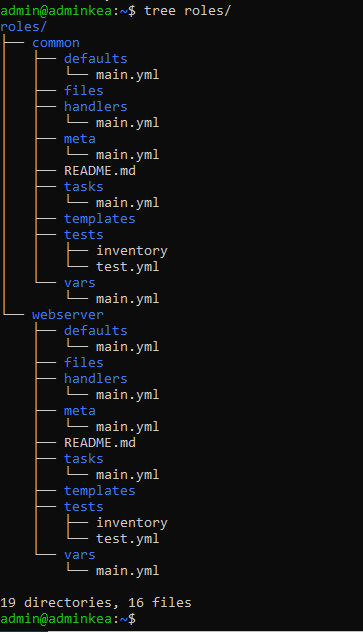
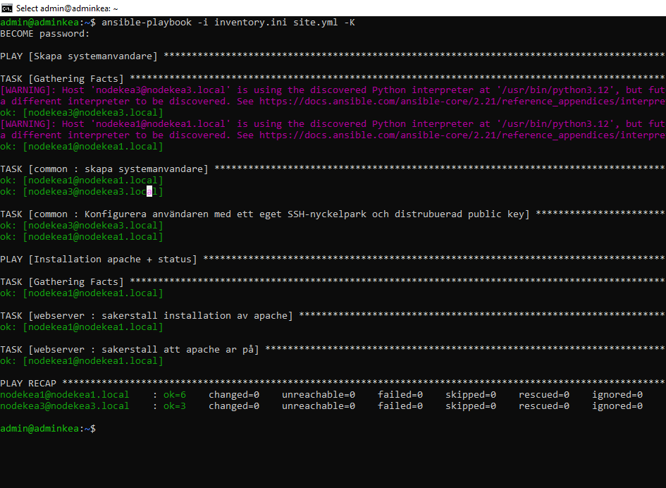

# Lab 5: Strukturering med Ansible Roles (VG)

Playbooks från tidigare labbar är uppdelade i två återanvändbara roller som skapats med `ansible-galaxy role init`. `site.yml` anropar båda rollerna.

## Roller

**common** (`nodes`)
- Användarskapandet från Lab 4 (`users.yml`).
- Skapar systemanvändaren `devops_admin` och lägger den i gruppen `sudo`.
- Lägger in den publika nyckeln `devops_admin.pub` i användarens `authorized_keys`.

**webserver** (`webservers`)
- Pakethanteringen från Lab 3: installerar Apache (`apache2`) med `ansible.builtin.apt`.
- Startar tjänsten med `ansible.builtin.service`.
- Handlern `starta om apache` startar om Apache när tasken som notifierar den har ändrat något.

## VG-krav

| Krav | Var |
|---|---|
| Rollstruktur med `ansible-galaxy role init roles/common` och `roles/webserver` | `roles/` (se mappträdet nedan) |
| Pakethantering och användarskapande från Lab 4 flyttat till roller | `roles/common/tasks/main.yml`, `roles/webserver/tasks/main.yml` |
| Tjänsten startas via `ansible.builtin.service` | `roles/webserver/tasks/main.yml` |
| Omstart med handler | `roles/webserver/handlers/main.yml` |
| `site.yml` anropar båda rollerna | `site.yml` |

## Körning

```bash
ansible-playbook -i inventory.ini site.yml -K
```

## Mappträd

```bash
tree roles/
```



## Körningsresultat



Körningen visar `changed=0` på båda noderna eftersom allt redan var på plats. Därför syns ingen handler: en handler körs bara när en task som notifierar den rapporterar `changed`.
