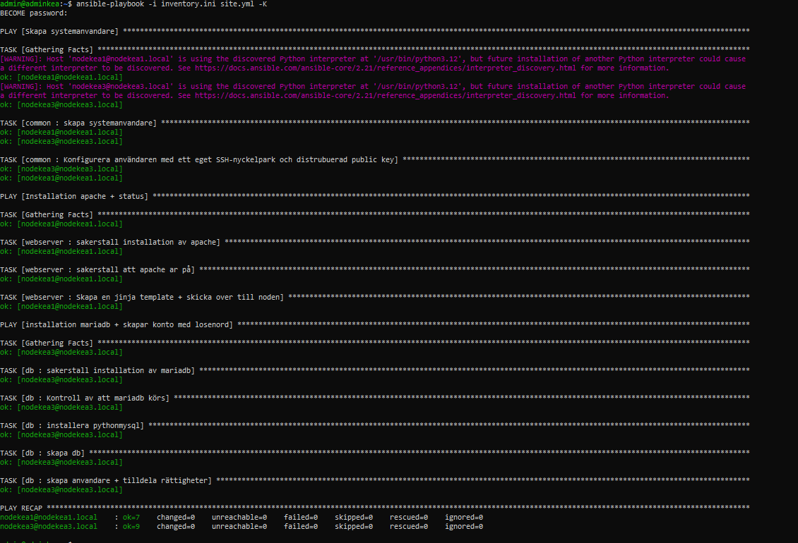
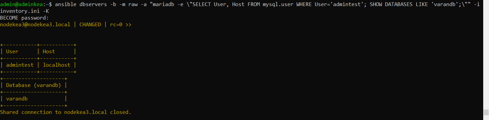

# Lab 7: Secrets Management med Ansible Vault (VG)

Databaslösenordet ligger krypterat med Ansible Vault. En ny roll, `db`, installerar MariaDB och skapar en databasanvändare med lösenordet från valvet.

## Roller

**common** (`nodes`): skapar `devops_admin` med SSH-nyckel (från Lab 4/5).

**webserver** (`webservers`): Apache med startsidan från Jinja2-mallen (från Lab 5/6).

**db** (`dbservers`, nodekea3)
- Installerar `mariadb-server`, `mariadb-client` och `galera-4`, och ser till att MariaDB körs.
- Installerar `python3-pymysql`, som Ansibles MariaDB-moduler behöver.
- Skapar databasen `varandb`.
- Skapar användaren `admintest` med lösenordet `vault_db_passwd` från valvet och ger den alla rättigheter på `varandb`.

## VG-krav

| Krav | Var |
|---|---|
| Krypterad variabelfil | `group_vars/all/vault.yaml` |
| Ny roll som installerar MariaDB | `roles/db` |
| Playbook som läser den krypterade filen och skapar en databasanvändare | `site.yml` + `roles/db/tasks/main.yml` |
| Körs med lösenordsfil, som hanteras korrekt i Git | `ansible.cfg` → `~/vault-secretpasswd.txt` |

## Så hanteras hemligheterna

- Lösenordet ligger bara i `group_vars/all/vault.yaml`, som är krypterad med AES256.
- Vault-lösenordet ligger i `~/vault-secretpasswd.txt` i hemkatalogen på kontrollnoden. Filen ligger utanför repot och kommer därför aldrig med i Git. `ansible.cfg` pekar på den, så playbooken kan köras utan att skriva in vault-lösenordet:

```ini
[defaults]
vault_password_file = ~/vault-secretpasswd.txt
```

## Valvet är oläsbart i Git

Så här ser `group_vars/all/vault.yaml` ut i repot:

```
$ANSIBLE_VAULT;1.1;AES256
31336530633961623232323833626531356432626639656138356135303234326633633163626536
6162396236303034343165376464396235636236353530650a383333656431376236643262373566
...
```

Innehållet kan bara läsas med vault-lösenordet:

```bash
ansible-vault view group_vars/all/vault.yaml
```

## Kommandon

```bash
# Skapa eller ändra valvet
ansible-vault create group_vars/all/vault.yaml
ansible-vault edit group_vars/all/vault.yaml

# Kör playbooken (vault-lösenordet läses från filen i ansible.cfg)
ansible-playbook -i inventory.ini site.yml -K

# Kontrollera att användaren och databasen finns
ansible dbservers -b -m raw -a "mariadb -e \"SELECT User, Host FROM mysql.user WHERE User='admintest'; SHOW DATABASES LIKE 'varandb';\"" -i inventory.ini -K
```

## Resultat

**Körning av site.yml**



**Användaren och databasen finns på nodekea3**



Användaren `admintest` finns med host `localhost`, och databasen `varandb` är skapad.
